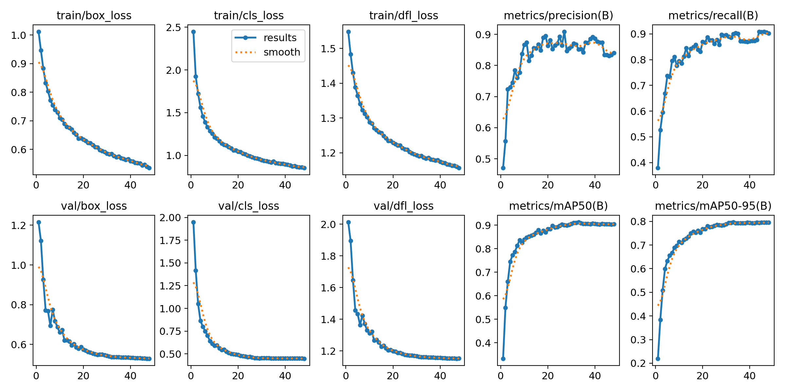
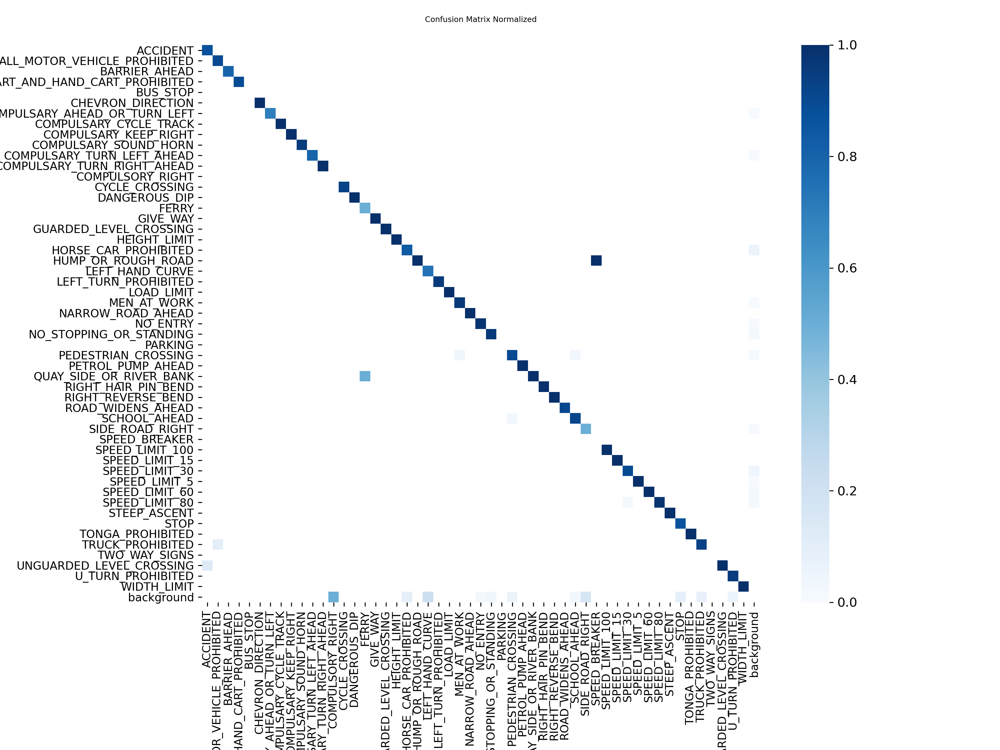
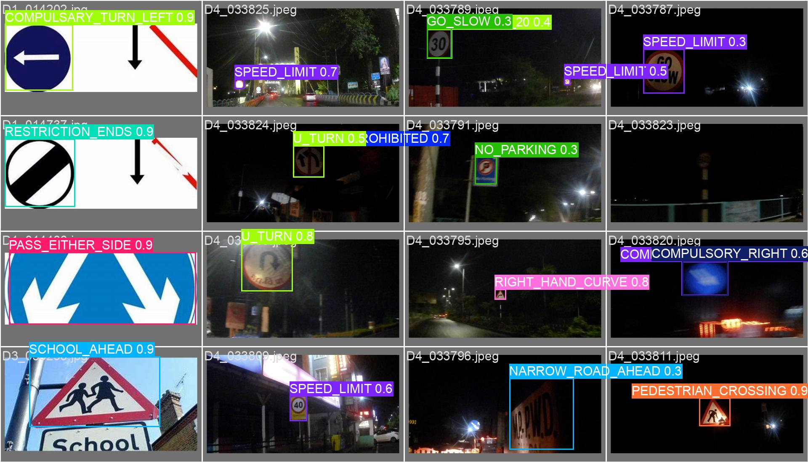

# 🚦 Indian Traffic Sign Detection using YOLO11

[](https://www.python.org/)
[](https://github.com/ultralytics/ultralytics)
[](https://pytorch.org/)
[](LICENSE)
[](runs/detect/indian_traffic_signs_merged/results.png)

A real-time deep learning system for detecting and classifying **104 distinct classes of Indian traffic and road signs** using **Ultralytics YOLO11s**. Designed for intelligent transportation systems (ITS), advanced driver assistance systems (ADAS), and autonomous navigation in diverse Indian road conditions.

---

## 📌 Table of Contents
- [Overview](#-overview)
- [Performance & Benchmark](#-performance--benchmark)
- [Training Results & Visualizations](#-training-results--visualizations)
- [Dataset Overview](#-dataset-overview)
- [Repository Structure](#-repository-structure)
- [Installation](#-installation)
- [Quick Start & Inference](#-quick-start--inference)
- [Model Evaluation](#-model-evaluation)
- [Training](#-training)
- [Class Labels (104 Signs)](#-class-labels-104-signs)
- [Citation & References](#-citation--references)

---

## 🔍 Overview

Indian roads present unique visual challenges for object detection: dense traffic, occlusions, varying lighting conditions, worn signboards, and unique regional sign variations. This repository delivers:
- **YOLO11 Small Architecture (`yolo11s.pt`)**: Balanced high-speed inference with rich spatial accuracy suitable for edge devices and GPUs.
- **104 Fine-Grained Classes**: Comprehensive coverage of mandatory (regulatory), cautionary (warning), and informatory traffic sign categories.
- **Robust Multi-Source Dataset**: Aggregated and standardized from top Indian road sign datasets (Roboflow Universe, Kaggle, IRTSD, INTSD).
- **Extensive Augmentations**: Trained with Mosaic, MixUp, Copy-Paste, HSV color jitter, and slight geometric transforms to withstand real-world road environments.

---

## 📊 Performance & Benchmark

The model achieved strong validation metrics on test splits:

| Metric | Score |
| :--- | :--- |
| **mAP@50 (Mean Average Precision @ IoU 0.50)** | **91.28%** |
| **mAP@50-95 (Mean Average Precision @ IoU 0.50:0.95)** | **79.68%** |
| **Precision** | **84.04%** |
| **Recall** | **90.28%** |
| **Input Image Resolution** | `640 x 640` |
| **Model Architecture** | YOLO11 Small (`yolo11s`) |

---

## 📈 Training Results & Visualizations

### Metrics & Loss Curves
Training progression over epochs depicting Box Loss, Class Loss, DFL Loss, Precision, Recall, and mAP metrics:



### Normalized Confusion Matrix
Detailed per-class classification accuracy across major traffic sign groups:



### Precision-Recall & F1 Curves
- **Precision-Recall Curve**: [BoxPR_curve.png](runs/detect/indian_traffic_signs_merged/BoxPR_curve.png)
- **F1-Confidence Curve**: [BoxF1_curve.png](runs/detect/indian_traffic_signs_merged/BoxF1_curve.png)

### Sample Model Predictions
Validation batch predictions demonstrating bounding box precision on challenging multi-sign road scenes:



---

## 🗂️ Dataset Overview

The dataset unifies multiple Indian traffic sign datasets, categorized into 104 standardized classes. Data sources and references:
- **Roboflow Universe**: [Indian Traffic Sign](https://universe.roboflow.com/sdi/indian-traffic-sign), [India Traffic Sign](https://universe.roboflow.com/college-opfvn/india-traffic-sign), [Indian Traffic Signboards](https://universe.roboflow.com/major-project-166na/indian-traffic-signboards)
- **Kaggle**: [Indian Traffic Sign Dataset](https://www.kaggle.com/datasets/neelpratiksha/indian-traffic-sign-dataset)
- **IEEE Dataport**: [IRTSD Dataset v1 (Indian Road Traffic Sign Detection)](https://ieee-dataport.org/documents/irtsd-datasetv1-indian-road-traffic-sign-detection-dataset)
- **INTSD**: [Indian Traffic Sign Dataset](https://adityamishra-ml.github.io/INTSD/download.html)
- See [dataset.txt](dataset.txt) for direct resource links.

The dataset configuration file is located at `merged_dataset/data.yaml`.

---

## 📁 Repository Structure

```
Traffic_Signs_Detection/
├── merged_dataset/
│   └── data.yaml                  # YOLO dataset configuration (104 classes & paths)
├── runs/
│   └── detect/
│       └── indian_traffic_signs_merged/
│           ├── args.yaml          # Training hyperparameters and environment
│           ├── results.csv        # Per-epoch training & validation metrics log
│           ├── results.png        # Training loss & mAP graphs
│           ├── confusion_matrix_normalized.png
│           ├── BoxF1_curve.png
│           ├── BoxPR_curve.png
│           └── val_batch0_pred.jpg
├── train.py                       # Training pipeline script
├── predict.py                     # Inference script (Images, Video, Webcam)
├── evaluate.py                    # Test set evaluation and metric generation
├── requirements.txt               # Python package dependencies
├── dataset.txt                    # Dataset citations and download links
├── yolo11s.pt                     # YOLO11 Small model checkpoint
├── .gitignore                     # Git ignore rules for archives & large files
└── README.md                      # Project documentation
```

---

## ⚙️ Installation

### 1. Clone the Repository
```bash
git clone https://github.com/Adi02032006/Traffic_Signs_Detection.git
cd Traffic_Signs_Detection
```

### 2. Create and Activate Virtual Environment
```bash
# Windows
python -m venv venv
venv\Scripts\activate

# Linux / macOS
python3 -m venv venv
source venv/bin/activate
```

### 3. Install Dependencies
```bash
pip install --upgrade pip
pip install -r requirements.txt
```

---

## 🚀 Quick Start & Inference

You can run predictions on images, video files, directories, or real-time webcam streams.

### Run via Command Line

```bash
# Predict on an image
python predict.py --source path/to/image.jpg

# Predict on a video file
python predict.py --source path/to/video.mp4

# Predict from live webcam (stream 0)
python predict.py --source 0

# Custom confidence and IoU thresholds
python predict.py --source path/to/image.jpg --conf 0.40 --iou 0.50

# Specify custom weights path
python predict.py --source path/to/image.jpg --weights yolo11s.pt
```

### Run in Python

```python
from ultralytics import YOLO

# Load model checkpoint
model = YOLO("yolo11s.pt")

# Perform inference on an image
results = model.predict(source="path/to/test.jpg", conf=0.35, save=True)

# Process detection bounding boxes
for r in results:
    for box in r.boxes:
        cls_id = int(box.cls[0])
        class_name = model.names[cls_id]
        confidence = float(box.conf[0])
        coords = box.xyxy[0].tolist()
        print(f"Detected {class_name} ({confidence:.2f}) at {coords}")
```

---

## 🧪 Model Evaluation

To evaluate model performance on the test split:

```bash
# Evaluate on test split (default)
python evaluate.py

# Evaluate with custom weights and data config
python evaluate.py --weights yolo11s.pt --data merged_dataset/data.yaml --split test
```

The script computes mAP@50, mAP@50-95, Precision, Recall, and outputs the top-performing and lowest-performing sign classes.

---

## 🏋️ Training

To train the model on your own hardware or retrain with new data:

```bash
python train.py
```

### Hyperparameters Overview
- **Base Architecture**: `yolo11s.pt`
- **Optimizer**: AdamW (`lr0=0.001`, `lrf=0.01`, cosine annealing)
- **Batch Size**: 16 (optimized for 8GB VRAM like NVIDIA RTX 4060)
- **Augmentations**: Mosaic (1.0), Mixup (0.1), Copy-Paste (0.1), Random Erasing (0.1)
- **Early Stopping**: Patience of 15 epochs

---

## 🏷️ Class Labels (104 Signs)

<details>
<summary>Click to view all 104 supported traffic sign classes</summary>

| ID | Class Name | ID | Class Name |
|---|---|---|---|
| 0 | ACCIDENT | 52 | NO_ENTRY |
| 1 | AIRPORT | 53 | NO_PARKING |
| 2 | ALL_MOTOR_VEHICLE_PROHIBITED | 54 | NO_STOPPING_OR_STANDING |
| 3 | AXLE_LOAD_LIMIT | 55 | OVERTAKING_PROHIBITED |
| 4 | BARRIER_AHEAD | 56 | PARKING |
| 5 | BULLOCK_AND_HANDCART_PROHIBITED | 57 | PASS_EITHER_SIDE |
| 6 | BULLOCK_CART_AND_HAND_CART_PROHIBITED | 58 | PEDESTRIAN_CROSSING |
| 7 | BULLOCK_PROHIBITED | 59 | PEDESTRIAN_PROHIBITED |
| 8 | BUS_STOP | 60 | PETROL_PUMP_AHEAD |
| 9 | CATTLE | 61 | PRIORITY_FOR_ONCOMING_VEHICLES |
| 10 | CHEVRON_DIRECTION | 62 | QUAY_SIDE_OR_RIVER_BANK |
| 11 | COMPULSARY_AHEAD | 63 | RESTRICTION_ENDS |
| 12 | COMPULSARY_AHEAD_OR_TURN_LEFT | 64 | RIGHT_HAIR_PIN_BEND |
| 13 | COMPULSARY_AHEAD_OR_TURN_RIGHT | 65 | RIGHT_HAND_CURVE |
| 14 | COMPULSARY_CYCLE_TRACK | 66 | RIGHT_REVERSE_BEND |
| 15 | COMPULSARY_KEEP_LEFT | 67 | RIGHT_TURN_PROHIBITED |
| 16 | COMPULSARY_KEEP_RIGHT | 68 | ROAD_WIDENS_AHEAD |
| 17 | COMPULSARY_MINIMUM_SPEED | 69 | ROUNDABOUT |
| 18 | COMPULSARY_SOUND_HORN | 70 | SCHOOL_AHEAD |
| 19 | COMPULSARY_TURN_LEFT | 71 | SIDE_ROAD_LEFT |
| 20 | COMPULSARY_TURN_LEFT_AHEAD | 72 | SIDE_ROAD_RIGHT |
| 21 | COMPULSARY_TURN_RIGHT | 73 | SLIPPERY_ROAD |
| 22 | COMPULSARY_TURN_RIGHT_AHEAD | 74 | SPEED_BREAKER |
| 23 | COMPULSORY_LEFT | 75 | SPEED_LIMIT |
| 24 | COMPULSORY_RIGHT | 76 | SPEED_LIMIT_100 |
| 25 | CROSS_ROAD | 77 | SPEED_LIMIT_120 |
| 26 | CYCLE_CROSSING | 78 | SPEED_LIMIT_15 |
| 27 | CYCLE_PROHIBITED | 79 | SPEED_LIMIT_20 |
| 28 | DANGEROUS_DIP | 80 | SPEED_LIMIT_30 |
| 29 | FALLING_ROCKS | 81 | SPEED_LIMIT_40 |
| 30 | FERRY | 82 | SPEED_LIMIT_5 |
| 31 | GAP_IN_MEDIAN | 83 | SPEED_LIMIT_50 |
| 32 | GIVE_WAY | 84 | SPEED_LIMIT_60 |
| 33 | GO_SLOW | 85 | SPEED_LIMIT_70 |
| 34 | GUARDED_LEVEL_CROSSING | 86 | SPEED_LIMIT_80 |
| 35 | HANDCART_PROHIBITED | 87 | STAGGERED_INTERSECTION |
| 36 | HEIGHT_LIMIT | 88 | STEEP_ASCENT |
| 37 | HORN_PROHIBITED | 89 | STEEP_DESCENT |
| 38 | HORSE_CAR_PROHIBITED | 90 | STOP |
| 39 | HOSPITAL_AHEAD | 91 | STRAIGHT_PROHIBITED |
| 40 | HUMP_OR_ROUGH_ROAD | 92 | TONGA_PROHIBITED |
| 41 | LEFT_HAIR_PIN_BEND | 93 | TRAFFIC_SIGNAL |
| 42 | LEFT_HAND_CURVE | 94 | TRUCK_PROHIBITED |
| 43 | LEFT_REVERSE_BEND | 95 | TURN_RIGHT |
| 44 | LEFT_TURN_PROHIBITED | 96 | TWO_WAY_SIGNS |
| 45 | LENGTH_LIMIT | 97 | T_INTERSECTION |
| 46 | LOAD_LIMIT | 98 | UNGUARDED_LEVEL_CROSSING |
| 47 | LOOSE_GRAVEL | 99 | U_TURN |
| 48 | MEN_AT_WORK | 100 | U_TURN_PROHIBITED |
| 49 | NARROW_BRIDGE_AHEAD | 101 | WARNING |
| 50 | NARROW_ROAD_AHEAD | 102 | WIDTH_LIMIT |
| 51 | NARROW_ROAD_LEFT_AHEAD | 103 | Y_INTERSECTION |

</details>

---

## 📜 Citation & References

If you use this work or the associated models in your research or project, please reference:
- Ultralytics YOLO11: [Ultralytics GitHub](https://github.com/ultralytics/ultralytics)
- Indian Traffic Sign Datasets: [INTSD](https://arxiv.org/pdf/2511.17183) & [IRTSD](https://ieee-dataport.org/documents/irtsd-datasetv1-indian-road-traffic-sign-detection-dataset)

---

## 📄 License
This project is open-source under the [MIT License](LICENSE).
